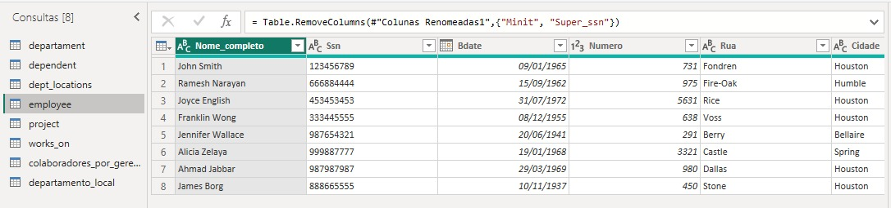
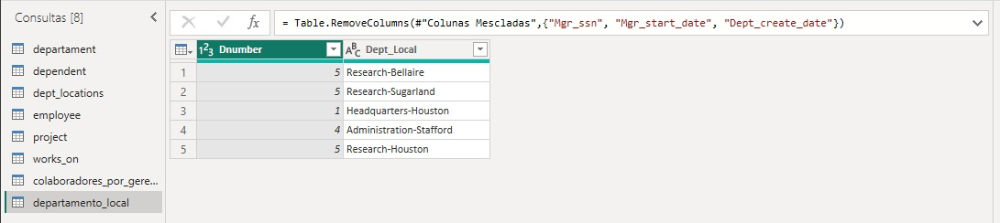
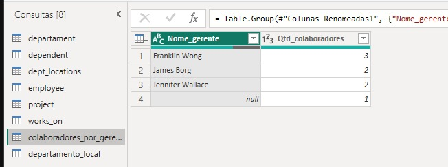

# Desafio DIO: Processando e Transformando Dados com Power BI

Projeto prático do desafio da DIO sobre integração e transformação de dados com Power BI, usando a base **Company** (funcionários, departamentos, projetos e dependentes).

## 🎯 Objetivo

Verificar problemas na base e transformar os dados no Power Query, deixando-os prontos para análise.

## ⚠️ Origem dos dados (diferença em relação ao enunciado)

O desafio pede um MySQL na Azure. Para não ter custo, **não usei a Azure**. Converti os scripts SQL da base Company (`script_bd_company.sql` e `insercao_de_dados_e_queries_sql.sql`) em um arquivo Excel (`company_dados.xlsx`), com uma aba por tabela, e importei esse arquivo no Power BI. As transformações no Power Query são as mesmas.

## 🔍 Verificações feitas

| Verificação | Resultado |
|---|---|
| Cabeçalhos e tipos de dados | Corrigidos: `Ssn`, `Super_ssn`, `Essn` e `Mgr_ssn` como texto (são códigos); datas como data; `Salary` e `Hours` como número decimal |
| Valores monetários | `Salary` como **número decimal** (double) |
| Nulos | Só `Super_ssn` do James Borg é nulo. Mantive: ele é o gerente geral e não tem chefe |
| Colaborador sem gerente | Apenas James Borg |
| Departamento sem gerente | Nenhum. Todos têm `Mgr_ssn` preenchido, então não precisei preencher lacunas |
| Horas dos projetos (`Hours`) | Sem valores nulos ou negativos. Maior: 40. Menor: 0 (James Borg, projeto 20). Mantive os registros |

## 🧹 Transformações

1. **Separar colunas complexas:** `Address` foi dividida em `Numero`, `Rua`, `Cidade` e `Estado`, pelo hífen. Dividi de trás para frente (primeiro o estado, depois a cidade, por último o número), porque algumas ruas têm duas palavras, como `Fire-Oak`.
2. **Mesclar `employee` com `departament`** (`Dno` = `Dnumber`), trazendo o nome do departamento (`Dname`).
3. **Mesclar colaborador com gerente:** mescla da `employee` com ela mesma (`Super_ssn` = `Ssn`), gerando `Nome_gerente`.
4. **Mesclar nome e sobrenome:** `Fname` e `Lname` viraram `Nome_completo`.
5. **Mesclar departamento e localização:** `departament` com `dept_locations` (`Dnumber`), e `Dname` + `Dlocation` viraram `Dept_Local` (ex.: `Research-Houston`). Fica uma combinação única por linha, o que ajuda no modelo estrela de um módulo futuro. O resultado está na tabela `departamento_local`.
6. **Agrupar:** a tabela `colaboradores_por_gerente` conta quantos colaboradores cada gerente tem (Franklin Wong: 3, James Borg: 2, Jennifer Wallace: 2; o `null` é o próprio James Borg).
7. **Eliminar colunas desnecessárias:**

| Tabela | Removi | Motivo |
|---|---|---|
| `employee` | `Minit`, `Super_ssn` | `Super_ssn` virou `Nome_gerente`; `Minit` não é usado |
| `departamento_local` | `Mgr_ssn`, `Mgr_start_date`, `Dept_create_date` | Só preciso de `Dnumber` e `Dept_Local` |
| `departament` | `Mgr_start_date`, `Dept_create_date` | Não entram no relatório |

## ❓ Perguntas do desafio

**Qual tipo de junção usei ao mesclar `employee` e `departament`?**
Junção **externa esquerda**, porque a base é a `employee`. Assim todos os funcionários são mantidos, mesmo que algum não tivesse departamento.

**Por que, na junção de departamento e localização, posso usar apenas "mesclar"?**
Porque as duas tabelas têm colunas diferentes e se relacionam por uma chave (`Dnumber`). Mesclar junta colunas lado a lado, ligando cada departamento ao seu local. Anexar apenas empilharia linhas e não faria essa ligação.

## 🖼️ Prints

## 📁 Conteúdo do repositório

- `desafio-3-power-bi.pbix`: projeto do Power BI
- `company_dados.xlsx`: dados da base Company em Excel
- `script_bd_company.sql` e `insercao_de_dados_e_queries_sql.sql`: scripts originais da base
- Prints das tabelas (`.jpeg`)

## ▶️ Como abrir

1. Instale o **Power BI Desktop** (gratuito, só para Windows).
2. Baixe o arquivo `desafio-3-power-bi.pbix`.
3. Abra no Power BI Desktop. As transformações estão em **Transformar dados**.

## 🧠 O que aprendi

Aprendi a corrigir tipos de dados, separar colunas, mesclar tabelas e agrupar dados no Power Query, e como cada escolha, como o tipo de junção, muda o resultado.

## 🔗 Referências

- Repositório do curso: https://github.com/julianazanelatto/power_bi_analyst
